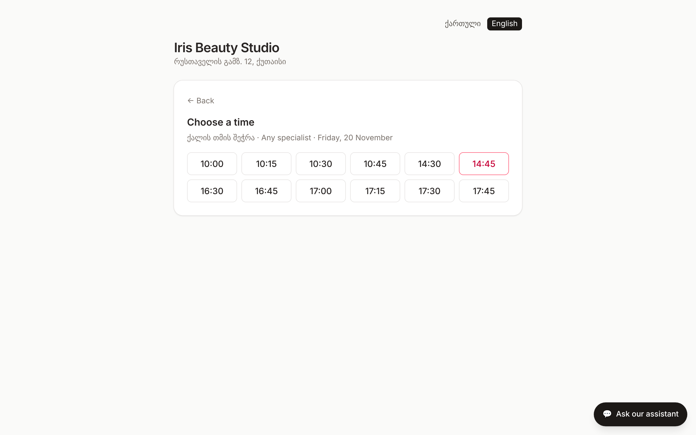
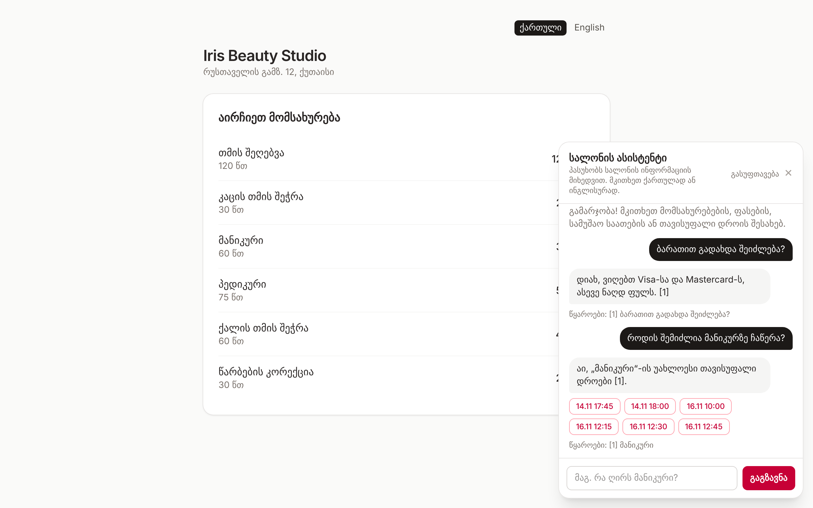
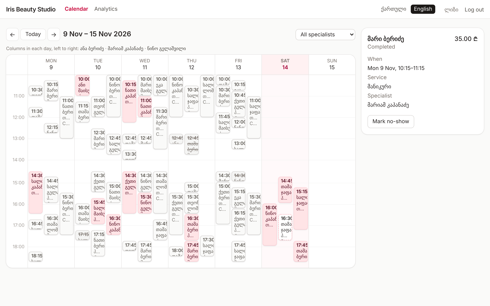
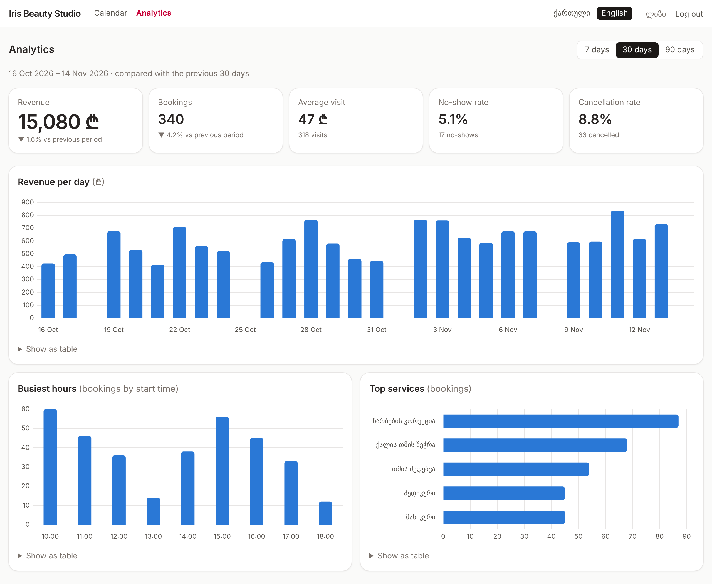
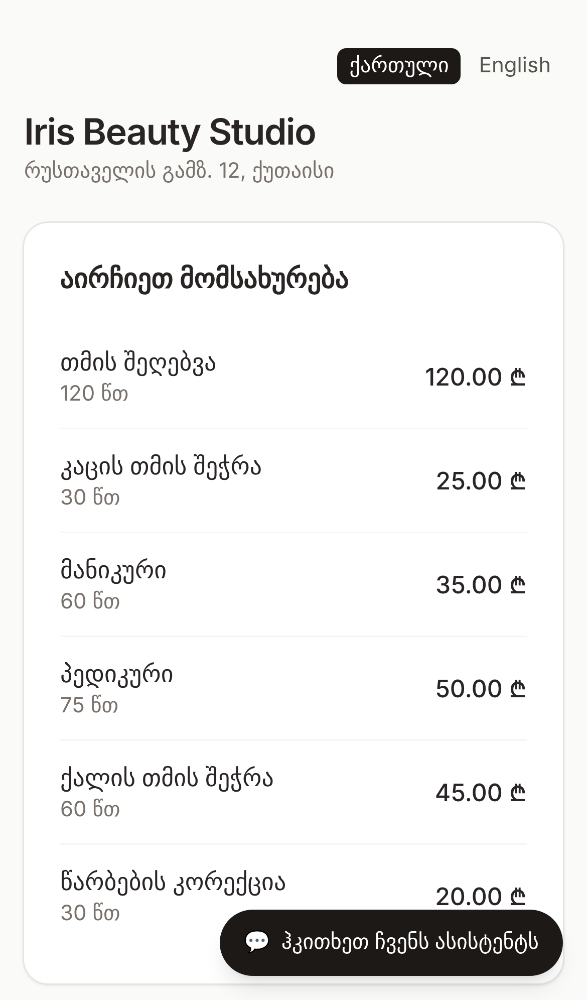
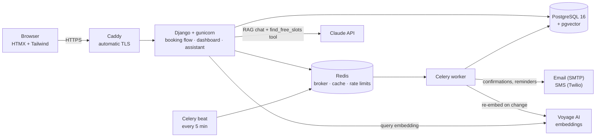

# SalonFlow 💇‍♀️

**Online booking + AI assistant platform for beauty salons** — built for and piloted at a real salon in Kutaisi, Georgia.

Clients book appointments online in Georgian or English, get automatic reminders, and can ask an AI assistant about services, prices and availability. Salon owners manage staff schedules and see revenue / occupancy analytics in a dashboard.

[](https://github.com/liizzieenn/salonflow/actions/workflows/ci.yml)
[](https://github.com/liizzieenn/salonflow/actions/workflows/deploy.yml)


[](https://github.com/psf/black)
[](https://github.com/astral-sh/ruff)

## Live demo

> **🔗 Live demo:** _coming soon — the server deploy is the last step of M7 ([deploy guide](docs/deploy.md))._

| What | Where | Login |
|---|---|---|
| Client booking page (Georgian / English) | `/s/demo/book/` · `/en/s/demo/book/` | — |
| Owner dashboard (calendar + analytics) | `/dashboard/` | `demo` / `salonflow-demo` |
| Staff view (own bookings only) | `/dashboard/` | `demo-staff` / `salonflow-demo` |

The demo salon is rebuilt nightly with `manage.py seed_demo --reset`, so feel free to
book, cancel and mark no-shows. Demo clients have no phone numbers or emails, so no
real person is ever messaged. Run the same demo locally in two commands; see
[Getting started](#getting-started).

## Screenshots

| Booking flow | AI assistant (Georgian, with free-time suggestions) |
|---|---|
|  |  |

| Owner calendar | Analytics |
|---|---|
|  |  |

<p align="center"></p>

## Features

**For clients**
- Browse services, prices and specialists; book a real free time in a few taps
- Confirmation plus email / SMS reminders 24 h and 2 h before the visit
- AI chat assistant (RAG) that answers from the salon's own data, cites its sources and
  suggests free times that link straight into the booking flow
- Georgian 🇬🇪 (default) / English 🇬🇧 interface; notifications in the client's language

**For salon owners & staff**
- Staff working hours, breaks and days off
- Week calendar of all bookings; mark visits completed / no-show or cancel
- Analytics: revenue, busiest hours, top services, no-show and cancellation rates
- Multi-tenant: every salon's data is isolated; staff see only their own bookings

## Tech stack

| Layer | Tech |
|---|---|
| Backend | Python 3.12, Django 5.2 |
| Database | PostgreSQL 16 + pgvector (HNSW), `btree_gist` exclusion constraint |
| Background jobs | Celery worker + beat, Redis (reminders, re-embedding) |
| AI | RAG over services/FAQ, Voyage AI embeddings, Claude API with tool use |
| Frontend | Django templates + HTMX 2 + Tailwind CSS 4 (compiled), Chart.js |
| Auth | Django auth (owner / staff roles per salon) |
| i18n | gettext, Georgian default + English, CI translation gate |
| Infra | Docker, Caddy (automatic HTTPS), gunicorn, GitHub Actions (CI + SSH deploy) |
| Testing | pytest, pytest-django, factory_boy, Playwright checks, full-stack smoke test in CI |

## Architecture



- **One Docker image** runs the web app, the Celery worker and beat; a multi-stage
  build compiles the Tailwind CSS and collects hashed static files (served by whitenoise).
- **Booking is safe under concurrency:** a row lock serialises bookings per specialist,
  and a PostgreSQL exclusion constraint makes double-booking impossible even if that is
  bypassed.
- **The assistant can't leak another salon's data:** retrieval and the slot tool are
  bound to one salon, and booking links are built by the app, never by the model.

## Getting started

### With Docker (recommended)

```bash
git clone https://github.com/liizzieenn/salonflow.git
cd salonflow
cp .env.example .env
docker compose up --build
docker compose exec web python manage.py seed_demo      # demo salon + logins
```

App: http://localhost:8000 · Booking page: http://localhost:8000/s/&lt;salon-slug&gt;/book/ (English: `/en/s/…`) · Dashboard: http://localhost:8000/dashboard/ · Admin: http://localhost:8000/admin/ · Health: http://localhost:8000/health/

### Without Docker

Requires Python 3.12+, Node 22, PostgreSQL 16 (with pgvector) and Redis.

```bash
python -m venv .venv && source .venv/bin/activate
pip install -r requirements/dev.txt
npm install && npm run build   # Tailwind CSS (`npm run dev` to watch)
cp .env.example .env   # point DATABASE_URL / REDIS_URL at localhost
python manage.py migrate
python manage.py seed_demo
python manage.py runserver
```

### Tests & code quality

```bash
pytest                 # runs against PostgreSQL (needed for exclusion constraints)
pytest --cov           # with coverage
ruff check . && black --check .
```

## Project structure

```
config/              settings (base / dev / test / prod), urls, celery app
apps/
  core/              shared models, health check, language switch, seed_demo
  accounts/          custom User model
  salons/            Salon, Service, Staff, WorkingHours, Break, TimeOff
  clients/           per-salon Client profiles
  bookings/          Booking, slot engine, booking service, HTMX booking flow
  notifications/     confirmation + reminder tasks, pluggable SMS backends
  dashboard/         owner/staff calendar, booking status, analytics
  assistant/         RAG chat: FAQ, pgvector index, pluggable LLM/embeddings
tests/               pytest suite + factory_boy factories
docker/              entrypoint, gunicorn config
deploy/              Caddyfile, server deploy script
docs/                deploy guide, screenshots
```

## How it works

### Booking engine

- **Slot engine** (`apps/bookings/slots.py`): free time = working hours − breaks −
  time off − existing bookings (each extended by its service's buffer). A start time is
  offered when the whole `duration + buffer` block fits, it lies on the salon's 15-minute
  grid and it is in the future. "Any specialist" merges every staff member's slots.
- **Booking service** (`apps/bookings/services.py`): `create_booking` runs in
  `transaction.atomic`, locks the staff row with `select_for_update()` and re-checks
  availability before inserting, so concurrent requests for the same staff member are
  serialised. A threaded test fires 8 simultaneous requests at one slot: exactly one wins.
- **Booking flow** (`apps/bookings/views.py`): service → specialist → day → time →
  details → confirmation. Every step is an HTMX fragment (`hx-boost`); without
  JavaScript or on refresh the same URL renders the full page.

### Notifications

- **Confirmation** email + SMS is queued with `transaction.on_commit` when a booking is
  created (never for a rolled-back booking; a broker outage doesn't fail the request).
- **Reminders 24h and 2h before** the visit: Celery beat runs
  `dispatch_due_reminders` every 5 minutes and queues every reminder whose send time has
  come. A reminder is skipped for cancelled bookings and for bookings made after its send
  time (the confirmation already covered them).
- **Exactly-once delivery:** every (booking, kind, channel) gets a `Notification` row
  (unique constraint) that is row-locked while sending. Retries (exponential backoff) and
  duplicate tasks never send twice, and a retry only re-sends the failed channel.
- **Pluggable SMS** (`apps/notifications/sms/`), configured like Django's email backends
  with `SMS_BACKEND`: `ConsoleBackend` (dev, prints to the worker log), `LocMemBackend`
  (tests) and `TwilioBackend` (production). A new provider only needs to implement
  `send_messages()`.
- Messages are rendered in the client's preferred language and the salon's time zone.

### Dashboard

- **Access control** (`apps/dashboard/access.py`): owners see their salon's whole
  calendar and analytics. Staff with a linked login see only their own bookings, and
  revenue analytics are owner-only (403). Anyone else gets a 404, so a salon's existence
  isn't revealed.
- **Week calendar:** bookings are positioned on a day × time grid in the salon's time
  zone. In the all-staff view each specialist has a fixed column; there is also a
  per-specialist filter. Clicking a booking opens a detail panel (HTMX) where staff can
  mark it completed or no-show, or cancel it, and the grid refreshes itself.
- **Analytics** (`apps/dashboard/analytics.py`): revenue, bookings, average visit,
  no-show and cancellation rates with change vs. the previous period, plus charts
  (Chart.js) for revenue per day, busiest hours and top services. Every chart also has
  a table view. All aggregation runs in PostgreSQL, grouped by the salon's local day
  and hour. Revenue counts completed visits plus past visits not flagged as no-show or
  cancelled.

### AI assistant

A chat widget on every salon's booking page answers questions in **Georgian or
English** from that salon's own data and suggests real free times.

- **Knowledge index** (`apps/assistant/knowledge.py`): each active service, FAQ entry
  (new `FAQ` model, editable in the admin) and the salon's contact details and opening
  hours become one embedded `KnowledgeChunk` in **pgvector** (HNSW index, cosine
  distance). Signals queue a Celery task on commit whenever a source changes, and
  unchanged text isn't re-embedded (content hash). `manage.py reindex_assistant` and an
  admin action rebuild everything.
- **RAG with citations** (`apps/assistant/chat.py`): retrieval is always filtered by
  salon. The model answers only from the numbered entries and cites them as `[n]`;
  citations pointing at anything that wasn't retrieved are dropped, and the widget lists
  the cited sources. The reply language follows the question (Georgian script →
  Georgian).
- **Free-slot suggestions:** a `find_free_slots` tool, bound to the current salon, runs
  the slot engine. The widget turns its results into booking buttons that open the
  booking flow at the details step; URLs written by the model are never used.
- **Pluggable providers** (`ASSISTANT_LLM_BACKEND`, `ASSISTANT_EMBEDDING_BACKEND`):
  Claude (`claude-opus-5-5` through the official `anthropic` SDK's tool runner, low
  effort, strict tool schema, server-side refusal fallbacks) and Voyage AI embeddings
  for production. Deterministic **fake providers** need no keys and are the default for
  development and tests.
- **Rate limits** (Redis): per client IP (6/minute, 60/day) and per salon (daily cost
  cap). If the cache is unreachable, requests are denied rather than allowed. Messages
  are capped at 500 characters and the history sent to the model at 6 messages.

### Georgian & English

- **Georgian is the default**, served without a URL prefix; English lives under `/en/`
  (`i18n_patterns`, `prefix_default_language=False`). The URL alone decides the
  language, so a link always opens in the language it was shared in.
- **Language switcher** in every header. It wraps Django's `set_language` so `next` is
  resolved in its own language, which makes switching from `/en/…` back to Georgian
  work whatever the cookie says.
- **Full Georgian catalogue** (`locale/ka/LC_MESSAGES/django.po`, 215 strings: booking
  flow, dashboard, analytics, assistant, emails, SMS, admin labels). Dates, weekdays
  and chart labels use Django's Georgian locale data.
- **Clients' language:** a client's `preferred_language` is saved from the language they
  book in, and every confirmation and reminder (email + SMS) is rendered in that
  language, whatever language the Celery worker is running in.
- **CI translation gate** (`tests/test_i18n.py`) fails on any untranslated, fuzzy or
  obsolete entry, on mismatched `%(name)s` placeholders, on a stale `.mo`, and on
  translatable strings in the code that were never extracted into the `.po`.

Updating translations:

```bash
python manage.py makemessages -l ka -e html,txt,py --ignore=.venv --ignore=staticfiles --ignore=tests --add-location=file --no-obsolete
# translate the new entries in locale/ka/LC_MESSAGES/django.po, then:
python manage.py compilemessages -l ka --ignore=.venv
```

### Data integrity highlights

- **No double-booking, enforced by PostgreSQL:** an `EXCLUDE USING gist` constraint
  (`btree_gist`) rejects any two non-cancelled bookings of the same staff member whose
  `[start, end)` ranges overlap — safe even under concurrent requests.
- **Multi-tenant by design:** every domain model is scoped to a `Salon`; model
  validation rejects bookings that mix clients, staff or services from different salons.
- Check constraints for valid time ranges, durations and prices; unique client phone
  per salon.

## Deployment

Production runs `docker-compose.prod.yml` on a single VPS: Caddy (automatic HTTPS) →
gunicorn, Celery worker + beat, PostgreSQL + pgvector and Redis. Pushes to `main` deploy
automatically over SSH once CI is green. Step-by-step guide: **[docs/deploy.md](docs/deploy.md)**.

## Roadmap

- [x] **M1 — Core:** project setup, Docker, models (Salon, Staff, Service, Booking, Client), admin
- [x] **M2 — Booking engine:** free-slot calculation, booking flow, conflict prevention, tests
- [x] **M3 — Notifications:** Celery + Redis, email/SMS reminders
- [x] **M4 — Dashboard:** owner calendar + analytics charts
- [x] **M5 — AI assistant:** pgvector embeddings, RAG chat over services/FAQ, slot suggestions
- [x] **M6 — i18n:** Georgian / English
- [ ] **M7 — Ship:** compiled Tailwind ✅, production stack + CI smoke test ✅, deploy workflow ✅,
  demo data ✅, screenshots ✅ — **live server + demo link** pending

## Author

**Lizi Dekanozishvili** — Full-Stack Developer · Kutaisi, Georgia
